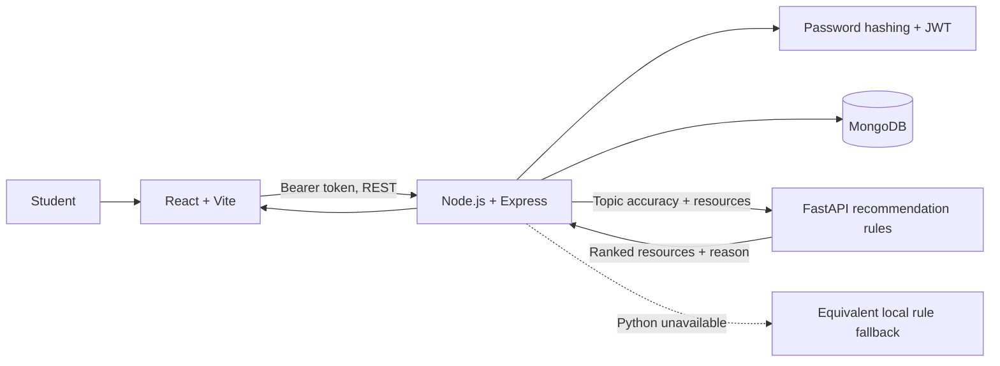

# System architecture

## Learning loop

1. The student selects a topic and requests a quiz. The API derives a suggested difficulty from recent attempts (the most recent five for that topic) and returns questions without answer keys.
2. The browser submits selected option indexes. The API checks that every answer is present and valid, grades against the stored answer key, records the attempt, and returns explanations.
3. Topic accuracy and resource metadata go to the Python service. It matches each topic to a resource at a suitable level and explains the match. If the service cannot respond, Node applies the same thresholds and returns the source as `local-fallback`.
4. The dashboard displays the updated progress and recommendations.

## Recommendation rules

| Recent topic accuracy | Suggested material | Quiz level |
| --- | --- | --- |
| No attempts or below 50% | Beginner | Easy |
| 50–84% | Intermediate | Medium |
| 85% or higher | Advanced | Hard |

Accuracy is the rounded mean of up to five latest attempts in the topic. These thresholds are a transparent demo policy and should be reviewed with educators before real use.
